<!--
  Hi! This README is generated for github.com/Miaoricle.
  ✏️  Text, links and badges below are safe to edit by hand.
  🐾  Images in ./profile/ are redrawn by GitHub Actions; change them via cat.config.json instead.
  📖  See SETUP.md for the full guide (themes, WakaTime, feeding the cat, troubleshooting).
-->

<div align="center">



<picture>
  <source media="(prefers-color-scheme: dark)" srcset="https://readme-typing-svg.demolab.com/?font=Fira+Code&weight=600&size=22&duration=2800&pause=1000&color=CBA6F7&center=true&vCenter=true&width=720&height=50&lines=Hey+there%2C+I%27m+Amir+%F0%9F%91%8B;Final-year+Software+Engineering+student;Flutter+%C2%B7+Python+%C2%B7+PHP+%C2%B7+C%23+%C2%B7+C%2B%2B+%C2%B7+JS;Freelance+web+%26+mobile+developer;Building+FitAlign%2C+a+Flutter+fitness+app;Powered+by+curiosity%2C+coffee+%26+cat+naps+%F0%9F%90%BE" />
  <source media="(prefers-color-scheme: light)" srcset="https://readme-typing-svg.demolab.com/?font=Fira+Code&weight=600&size=22&duration=2800&pause=1000&color=8839EF&center=true&vCenter=true&width=720&height=50&lines=Hey+there%2C+I%27m+Amir+%F0%9F%91%8B;Final-year+Software+Engineering+student;Flutter+%C2%B7+Python+%C2%B7+PHP+%C2%B7+C%23+%C2%B7+C%2B%2B+%C2%B7+JS;Freelance+web+%26+mobile+developer;Building+FitAlign%2C+a+Flutter+fitness+app;Powered+by+curiosity%2C+coffee+%26+cat+naps+%F0%9F%90%BE" />
  
</picture>


<a href="https://github.com/Miaoricle/Miaoricle/issues/new?title=%F0%9F%90%9F%20feed-the-cat&body=Just%20press%20%2A%2ACreate%2A%2A%20to%20toss%20Miao%20a%20fish%20%F0%9F%90%9F%0A%0AA%20bot%20will%20say%20thanks%20and%20close%20this%20issue%20within%20a%20minute%20or%20two.%20Each%20visitor%20can%20feed%20Miao%20once%20every%2012%20hours."></a>

</div>

## 🐾 About me

<a href="https://github.com/Miaoricle/Miaoricle/issues/new?title=%F0%9F%90%9F%20feed-the-cat&body=Just%20press%20%2A%2ACreate%2A%2A%20to%20toss%20Miao%20a%20fish%20%F0%9F%90%9F%0A%0AA%20bot%20will%20say%20thanks%20and%20close%20this%20issue%20within%20a%20minute%20or%20two.%20Each%20visitor%20can%20feed%20Miao%20once%20every%2012%20hours."></a>

- 🎓 Final-year **Software Engineering** student at **UniKL MIIT** · 🏆 Dean's List ×3
- 🏃 Building **FitAlign**, an all-in-one Flutter fitness app (my final year project)
- 💼 **Freelance developer**: web & mobile builds for real clients
- 🤖 Exploring **machine learning & computer vision** (TensorFlow, MediaPipe, Roboflow)
- 📊 Turning data into stories with **Python**, Pandas and NetworkX
- 🎯 Goal: grow into a well-rounded software engineer · **open to internships** 🟢
- 💬 Ask me about **Flutter**, **PHP/MySQL** or **data visualisation**
- ⚡ Fun fact: my handle is part cat, part oracle. The Miaoricle answers at the bottom of this page 🔮

<details>
<summary><b>🧾 cat profile.yaml</b> <sub>(the details)</sub></summary>

```yaml
name        : Amir Nazhan
university  : Universiti Kuala Lumpur, Malaysian Institute of Information Technology (UniKL MIIT)
degree      : Bachelor in Software Engineering (2023 – 2027)
cgpa        : 3.59 (Degree) · 3.25 (Diploma)
dean_list   : Semester 1, 3 & 4
workshop    : Machine Learning for Assistive Technology · ITS, Indonesia
based_in    : Kuala Lumpur, Malaysia 🇲🇾
speaks      : English (fluent) · Bahasa Melayu (fluent)
status      : open to internships & freelance work 🟢
cat         : Miao (orange, pixelated, will accept fish)
```

</details>

<details>
<summary><b>😺 Pet the cat</b> <sub>(go on, click)</sub></summary>
<br />
<div align="center"></div>
</details>

<br clear="right" />


## 🧶 Tech stack
<sub>The ball of yarn I play with every day. Hover a badge to see where I've used it.</sub>

<table>
<tr>
<td width="150"><b>💬 Languages</b></td>
<td>


</td>
</tr>
<tr>
<td width="150"><b>🧩 Frameworks & Libraries</b></td>
<td>


</td>
</tr>
<tr>
<td width="150"><b>🗄️ Databases</b></td>
<td>


</td>
</tr>
<tr>
<td width="150"><b>🛠️ Developer Tools</b></td>
<td>


</td>
</tr>
<tr>
<td width="150"><b>🛰️ APIs, AI & Hardware</b></td>
<td>


</td>
</tr>
</table>

## 📊 GitHub metrics
<sub>Refreshed every 6 hours by a very diligent (and slightly hungry) GitHub Action.</sub>

<div align="center">








<!-- ⏱️ WakaTime: after you add the WAKATIME_USERNAME variable (SETUP.md, step 7), delete this line and the "end WakaTime" line below.

end WakaTime -->

</div>

## 🚀 Featured projects
<sub>Things I've built (and occasionally knocked off the table).</sub>

<table>
<tr>
<td width="50%" valign="top">

### 🏃 FitAlign


An all-in-one fitness companion: **workouts, running, yoga and diet tracking** in a single Flutter app, with GPS run tracking on Google Maps, voice guidance through text-to-speech and Stripe payments. Built around user-behaviour data and digital-experience analytics.

`Flutter` `Dart` `SQLite` `Google Maps` `Stripe` `TTS`

</td>
<td width="50%" valign="top">

### 📊 [Wikipedia Edit Pattern Analysis](https://github.com/Miaoricle/wikipedia-edit-analysis)


Who edits Wikipedia, and how do they collaborate? Pulls edit histories from the MediaWiki API, builds a contributor network with **NetworkX** and maps the activity patterns with **Matplotlib**.

`Python` `Pandas` `NetworkX` `Matplotlib` `MediaWiki API`

<a href="https://github.com/Miaoricle/wikipedia-edit-analysis"></a>

</td>
</tr>
<tr>
<td width="50%" valign="top">

### 🦾 ML for Assistive Technology


A **gesture-controlled wheelchair** prototype: an ESP32 drives the chair while TensorFlow and MediaPipe recognise hand gestures in real time. Built at an international workshop on machine learning for assistive tech at ITS, Indonesia.

`TensorFlow` `MediaPipe` `ESP32` `Python` `HCI`

</td>
<td width="50%" valign="top">

### 🌐 RICA Complaint System


A full-stack **PHP/MySQL** web system where residents submit and track complaints online, from the first report to the final resolution.

`PHP` `MySQL` `JavaScript` `HTML` `CSS`

</td>
</tr>
<tr>
<td width="50%" valign="top">

### 🎮 Game Vault


A **C#** desktop app for organising a personal digital game collection, with HTML/CSS views and a focus on clean data structures and interface design.

`C#` `HTML` `CSS` `Desktop`

</td>
<td width="50%" valign="top">

### 🧺 Laundry Management System


A command-line **C++** system for managing laundry orders, built as a team with Git and GitHub pull requests.

`C++` `OOP` `CLI` `Git` `Teamwork`

</td>
</tr>
</table>


## 🤝 Let's connect
<sub>I reply faster than a cat hears a can opener.</sub>

<div align="center">

<a href="https://linkedin.com/in/amirnazhan"></a>
<a href="mailto:amirnazhann@gmail.com"></a>
<a href="https://github.com/Miaoricle"></a>
<a href="https://github.com/Miaoricle/Miaoricle/issues/new?title=%F0%9F%90%9F%20feed-the-cat&body=Just%20press%20%2A%2ACreate%2A%2A%20to%20toss%20Miao%20a%20fish%20%F0%9F%90%9F%0A%0AA%20bot%20will%20say%20thanks%20and%20close%20this%20issue%20within%20a%20minute%20or%20two.%20Each%20visitor%20can%20feed%20Miao%20once%20every%2012%20hours."></a>
<!-- ✏️ Portfolio: replace the link below, then delete this line and the "end portfolio" line.
<a href="https://your-portfolio.example"></a>
end portfolio -->
<!-- ✏️ Discord: put your numeric user ID in the link (Discord > Settings > Advanced > Developer Mode, then right-click your name > Copy User ID).
<a href="https://discord.com/users/YOUR_DISCORD_USER_ID"></a>
end discord -->

</div>

## 🔮 Ask the Miaoricle
<sub>A new prophecy every day. Results not guaranteed, but the cat is very confident.</sub>

<div align="center">





<sub>Pixel cats and cards are drawn by <a href="./scripts/cat_widgets.py">a little script</a> and GitHub Actions · stats by <a href="https://github.com/stats-organization/github-readme-stats-action">GitHub Readme Stats</a> · typing by <a href="https://github.com/DenverCoder1/readme-typing-svg">readme-typing-svg</a> · palette: <a href="https://catppuccin.com">Catppuccin Mocha</a></sub>

</div>
